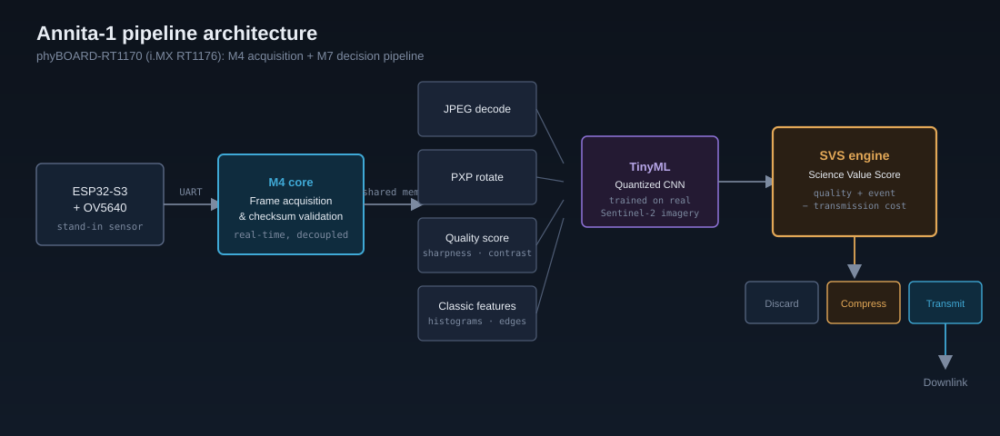

# Annita-1

Onboard image triage for small satellites, running on the PHYTEC phyBOARD-RT1170 (NXP i.MX RT1176, Cortex-M7 + Cortex-M4, Zephyr).

Each frame is scored before it is transmitted and gets one of three outcomes: discard, compress further, or transmit. The point is to spend downlink bandwidth only on frames worth sending.



Live replay of a recorded run: `https://AlejandroxConti.github.io/annita1/console/`

## Pipeline using (Conti Algorithm SVS)

1. JPEG decode (TJpgDec) and 180 degree rotation on the PXP
2. Image quality score: Laplacian-variance sharpness and contrast
3. Classical features: RGB565 histograms, Sobel edge density, blue dominance in a region of interest
4. Water/land classifier: int8 CNN trained on EuroSAT (Sentinel-2), TFLite Micro with CMSIS-NN
5. Science Value Score (SVS): quality, event likelihood and transmission cost combined into a single decision

The camera is an ESP32-S3 with an OV5640. It is a stand-in sensor; nothing in the pipeline depends on it.

## Repository layout

```
firmware/m7-vision-pipeline/   Cortex-M7 app: decode, PXP, IQA, features, TinyML, SVS
firmware/m4-acquisition/       Cortex-M4 app: UART frame receiver
esp32/camera-firmware/         Arduino sketch: capture, JPEG, framed UART output
docs/                          Write-up, diagrams, replay page
```

## Camera link

The ESP32 sends a JPEG roughly every 2 s over UART, 115200 8N1:

```
0xAA 0x55 [len_lo] [len_hi] [JPEG bytes] [XOR of the JPEG bytes]
```

The M4 parses the stream with a small state machine and only publishes a frame to shared memory once the checksum matches:

```c
switch (state) {
case ST_WAIT_AA: if (c == 0xAA) state = ST_WAIT_55; break;
case ST_WAIT_55: state = (c == 0x55) ? ST_LEN_LO : ST_WAIT_AA; break;
case ST_LEN_LO:  frame_len = c; state = ST_LEN_HI; break;
case ST_LEN_HI:
	frame_len |= (uint16_t)c << 8;
	if (frame_len == 0 || frame_len > JPEG_MAX) {
		state = ST_WAIT_AA;
	} else {
		idx = 0; checksum = 0; state = ST_PAYLOAD;
	}
	break;
case ST_PAYLOAD:
	shm_jpeg[idx++] = c;
	checksum ^= c;
	if (idx >= frame_len) state = ST_CHECKSUM;
	break;
case ST_CHECKSUM:
	if (c == checksum) publish_frame(frame_len);
	state = ST_WAIT_AA;
	break;
}
```

## Starting the M4 from the M7

The M4 image is built separately, embedded in the M7 app as a C array, copied to RAM at boot and released from reset:

```c
memcpy((void *)M4_BOOT_ADDRESS, g_m4_image, g_m4_image_len);
sys_cache_data_flush_range((void *)M4_BOOT_ADDRESS, g_m4_image_len);

IOMUXC_LPSR_GPR->GPR0 = IOMUXC_LPSR_GPR_GPR0_CM4_INIT_VTOR_LOW(M4_VTOR_ADDRESS >> 3u);
IOMUXC_LPSR_GPR->GPR1 = IOMUXC_LPSR_GPR_GPR1_CM4_INIT_VTOR_HIGH(M4_VTOR_ADDRESS >> 16u);

SRC->CTRL_M4CORE = SRC_CTRL_M4CORE_SW_RESET_MASK;
SRC->SCR |= SRC_SCR_BT_RELEASE_M4_MASK;
```

Things that cost time and are worth knowing if you do the same on this board:

- The M4 `.bin` is built with `CONFIG_ROM_START_OFFSET=0x2000`, so the vector table sits at the load address plus `0x2000`, not at the start of the blob. Pointing VTOR at the base gives a core that never runs.
- Flush the M7 data cache after the copy. The M4 reads RAM directly and can otherwise see stale bytes.
- The reset write to `SRC->CTRL_M4CORE` before `BT_RELEASE_M4` mirrors what Zephyr's own `second_core_boot()` does. Without it the M4 booted unreliably.
- A byte array holding the TFLite model needs `alignas(16)`. Unaligned, `AllocateTensors()` hangs with an unaligned-access fault.
- `CONFIG_HEAP_MEM_POOL_SIZE` defaults to 0 here, which makes `ipc_service_open_instance()` fail with `-ENOMEM`.
- With the shared-memory hand-off, invalidate the cache on the M7 side before reading what the M4 wrote.

## Build

The apps were built inside a PHYTEC `zephyr-phytec-application` west workspace, each one under `my_apps/`. Board targets are `phyboard_atlas/mimxrt1176/cm4` and `phyboard_atlas/mimxrt1176/cm7`.

```bash
# M4
west build -b phyboard_atlas/mimxrt1176/cm4 -d build_m4 my_apps/m4-acquisition

# embed the M4 binary in the M7 app (generated file, not committed)
(cd build_m4/zephyr && xxd -i zephyr.bin) \
  | sed -E 's/^unsigned char [A-Za-z0-9_]+\[\]/unsigned char g_m4_image[]/; s/^unsigned int [A-Za-z0-9_]+ =/unsigned int g_m4_image_len =/' \
  > my_apps/m7-vision-pipeline/src/m4_image/m4_image_data.c

# M7
west build -b phyboard_atlas/mimxrt1176/cm7 -d build my_apps/m7-vision-pipeline
west flash -d build
```

## Measured results

| | |
|---|---|
| JPEG on the ESP32 | 307,200 B raw to about 3.5 kB, ~135 ms per frame |
| M7 stage timings | decode 10-18 ms, IQA ~65 ms, features ~15 ms, inference ~12 ms |
| Classifier | 98.44% int8 accuracy, EuroSAT water vs. land |
| 80 frames | 75 discarded, 5 compressed, 0 transmitted in full: 254,921 B saved, 8,408 B sent |
| 415 frames, 19.6 min | no gaps or drift, 1,684,392 B saved (317 discarded, 97 compressed), land and water scenes swapped several times during the run |
| M4 to M7 hand-off | real camera JPEGs received on the M4 and passed through shared memory, roughly 75-80% of frames validated, no core lockups |

## Status

- The M4 receiver polls the UART. An interrupt-driven receiver stalled the core in testing, so completeness was traded for stability.
- The M7 pipeline and the M4 receiver each run on the board. Running them together as one continuous loop is not finished.
- Ideas for later: extra SVS terms (battery, contact window), more classes such as clouds, a different sensor.

## Notes

`esp32/camera-firmware` is adapted from a vendor LVGL camera example; the framed UART output and JPEG path are additions. TJpgDec is by ChaN and keeps its own license header.

Built for the PHYTEC / NXP phyBOARD-RT1170 Design Contest.
